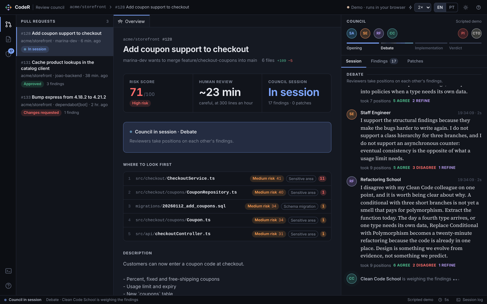
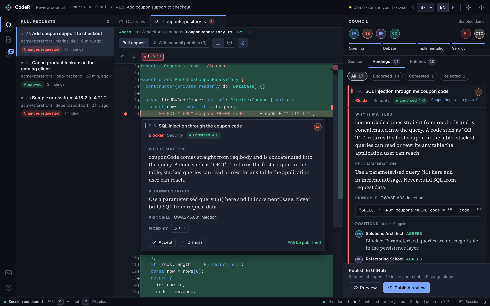
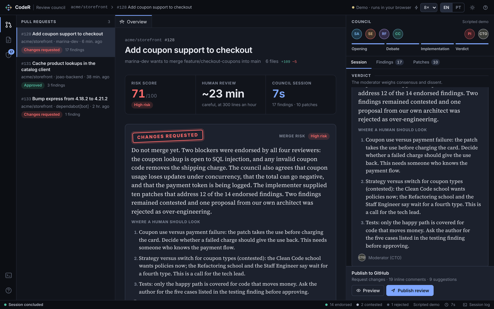

# CodeR

**A senior review council for every pull request, in an IDE-grade workspace.**

A tech lead cannot read every pull request. CodeR convenes a council of
specialised AI reviewers on each one. They examine the change through
different lenses, *debate* each other's findings, an implementer writes the
patches, and a moderator issues a verdict. You open one screen, see the code
that is going up, where the risk is and what the council agreed on, decide in
minutes, and publish the review to GitHub.



| A finding inside the code, with the debate beside it | The verdict, and where a human should look |
|---|---|
|  |  |

## Why a council and not a bot

1. **Several lenses.** Architecture, correctness and security, refactoring,
   clean code. One prompt cannot hold them all at full depth.
2. **Debate is the filter.** A finding that survives cross-examination is worth
   your time. One the panel argues against is probably noise. The consensus is
   computed by a deterministic rule, not by a model.
3. **Show the code.** The implementer turns what survived into patches you can
   preview on the file and publish as GitHub suggestions.
4. **You see why.** Every position, every dissent and every event of the
   session is on screen and stored.

| Seat | Speaks in | Lens |
|---|---|---|
| Solutions Architect | Opening, debate | Boundaries, coupling, dependency direction, data ownership, operability |
| Staff Engineer | Opening, debate | Correctness, edge cases, concurrency, security, performance, tests |
| Refactoring School | Opening, debate | Code smells, named refactorings, small safe steps, YAGNI |
| Clean Code School | Opening, debate | SOLID, naming, function size, the Dependency Rule, TDD |
| Pragmatic Implementer | Implementation | Writes the smallest patch that fixes it, declines what is not worth it |
| Moderator (CTO) | Verdict | Weighs consensus and dissent, tells the human where to look |

The Refactoring and Clean Code schools are in deliberate tension about when
an abstraction pays for itself. That argument is the discussion you get to
read.

The seats are archetypes inspired by published work and public engineering
style: Martin Fowler's *Refactoring*, Robert C. Martin's *Clean Code*, Linus
Torvalds' approach to patches. CodeR never claims to be, or to speak for, any
of these people.

## Try it in one minute

You need Node.js 22 or newer. Nothing else: no keys, no network.

```bash
npm install
npm run build
npm start
```

Open <http://127.0.0.1:4317>. Three sample pull requests are waiting. Open
"Add coupon support to checkout", press **Convene the council** and watch the
session. This is demo mode: a scripted council replays a real-looking session
on sample code, so it costs nothing and works offline.

There is also a single-file version of the demo, useful for sending to someone
or presenting without a server:

```bash
npm run build:demo
```

Then open `web/dist-standalone/coder-demo.html` in a browser. In that file the
whole application, the same domain and application code the server runs,
executes inside the browser tab.

## Use it on real pull requests

Copy `.env.example` to `.env` and fill in what you need. The file documents
every setting. Keep keys in that file only: it is ignored by git.

```bash
cp .env.example .env
```

| You set | You get |
|---|---|
| `ANTHROPIC_API_KEY` | The real council: Claude reviews any pull request you open. |
| `GITHUB_TOKEN` | Private repositories and publishing reviews. A fine-grained token with *Pull requests: read and write* and *Contents: read-only*. |
| `GITHUB_REPOSITORIES=owner/repo,owner/other` | The open pull requests of those repositories in the inbox. |
| `AUTO_REVIEW=true` | The council reviews every new commit of every open, non-draft pull request, without anyone asking. |

Then `npm run build && npm start`.

- **One pull request, right now.** Paste its URL in the box above the inbox.
  Public pull requests can be read without a GitHub token.
- **A whole repository.** List it in `GITHUB_REPOSITORIES`.
- **Automatically.** With `AUTO_REVIEW=true` CodeR polls the listed
  repositories. Pull requests that were already open when it started are the
  baseline and are not reviewed, so switching it on never triggers a burst of
  paid reviews. Instead of polling you can point a GitHub webhook (event *Pull
  requests*, content type `application/json`) at `POST /api/webhooks/github`
  and set `GITHUB_WEBHOOK_SECRET`.

**Cost.** A session is ten model calls: four opening statements, four debate
statements, the implementer and the moderator. The pull request is sent once
and the other nine calls read it from the prompt cache. The status bar shows
the tokens and the estimated cost of each session. `CODER_MODEL` and
`CODER_EFFORT` are the two dials.

## How a review works

```
convene ──▶ opening ──▶ debate ──▶ consensus ──▶ implementation ──▶ verdict ──▶ you ──▶ GitHub
            4 lenses    positions   a rule,       patches for        moderator   accept,   one review,
            in parallel on each     no model      what survived      + policy    dismiss   inline comments
                        other's                                                            and suggestions
                        findings
```

**Consensus** is a rule over the positions the other reviewers took. The
author of a finding counts as support. A finding is *endorsed* when support
outweighs opposition by two or more, *rejected* when opposition is larger,
*contested* in between, and *unreviewed* if nobody else spoke.

**The verdict is bounded by consensus.** The council cannot approve while an
endorsed blocker exists, and the merge risk is never lower than what the
endorsed findings imply. When the policy overrides the moderator, the review
says so.

**You decide.** Accept or dismiss any finding or patch. Your decision always
wins over the council's.

**What gets published.** A finding is published when you accepted it, or when
the council endorsed it and you did not dismiss it. It becomes an inline
comment when its line is part of the diff, otherwise it goes into the review
summary. A patch becomes a GitHub suggestion the author can commit with one
click. A session is published once, and only against the commit it reviewed:
if the pull request has new commits, CodeR refuses and asks you to convene the
council again.

## The workspace

- **Inbox** with the state of each pull request: not reviewed, in session,
  the verdict, new commits since the review.
- **Overview**: risk score, an estimate of what a careful human review would
  take, the verdict, and the files to read first.
- **Diff editor** (the editor VS Code is built on) side by side or inline,
  unchanged regions folded, findings marked in the gutter. Selecting a finding
  opens its card under the line.
- **With council patches**: the same file after the implementer's patches.
- **Council chamber**: the live transcript, the findings by consensus level,
  the patches, and the publish bar.
- **Session log**: every domain event of the session, in order.
- English and Portuguese, dark and light, and a phone layout.

| Key | |
|---|---|
| `n` / `p` | Next and previous finding |
| `a` / `d` | Accept or dismiss the selected finding |
| `o` | Overview |
| `l` | Session log |
| `?` | Shortcuts |

## Security notes

- The server listens on `127.0.0.1` only. To expose it, set `HOST=0.0.0.0`
  **and** `CODER_API_TOKEN`: every API call must then carry
  `Authorization: Bearer <token>`.
- Webhooks are accepted only when `GITHUB_WEBHOOK_SECRET` is set, and their
  signature is verified.
- Pull request titles, descriptions and file contents are presented to the
  models as material to review, not as instructions. Treat the output as a
  review to read, which is why nothing is published without a person pressing
  the button, except what you opt into with `AUTO_REVIEW` (which reviews, and
  still does not publish).
- Keys live in `.env` on your machine. They are never sent to the browser.

## What is verified, and what is not

| | |
|---|---|
| Domain rules, protocol, consensus, verdict policy, patching, publication planning | Unit tests |
| Demo council end to end, in English and Portuguese | Tests, plus the browser at desktop, wide and phone sizes |
| Server over HTTP with live event streaming, restart, API token, webhooks, import by URL | Tests against a running server |
| Claude council | Tests drive the official SDK against a local server that speaks the Messages API streaming wire format: request shape, prompt caching order, model fallback, refusals, truncation, a rejected key |
| GitHub adapter | Tests drive Octokit against a local server that speaks the REST API: pagination, merge base, file contents, publishing, and GitHub refusing a review |
| **The real Anthropic and GitHub APIs** | **Not exercised yet.** This build was made in an environment without credentials. Expect to adjust details the first time you run it with real keys. |

```bash
npm test          # 75 tests
npm run typecheck
```

## Development

```bash
npm run dev        # API on :4317 with reload, web on :5173 with hot reload
npm run build      # web/dist and dist
npm run build:demo # web/dist-standalone/coder-demo.html, one self-contained file
```

```
src/domain/          the business: change sets and risk, the review session, policies
src/application/     use cases and ports (what the application needs from the outside)
src/infrastructure/  adapters: Claude, GitHub, HTTP, persistence, the scripted demo
src/composition/     where adapters are wired to the application (server, standalone)
web/src/             the workspace (React, Monaco)
tests/               everything above, without the network
docs/                the domain model, the architecture, and the council's review of this code
```

Read next:

- [docs/DOMAIN.md](docs/DOMAIN.md): the business problem, the ubiquitous
  language, bounded contexts, aggregates, events and the protocol. Written
  before the code.
- [docs/ARCHITECTURE.md](docs/ARCHITECTURE.md): how the code is organised and
  why.
- [docs/COUNCIL_REVIEW.md](docs/COUNCIL_REVIEW.md): the council reviewed its
  own codebase. Findings, debate, verdict and what was fixed.

## Roadmap

- Learn from human decisions: what a team dismisses tunes its council.
- Team-specific seats and policies ("our architecture rules").
- Re-review on new commits: resolved versus still open.
- GitLab, Azure DevOps and Bitbucket adapters.
- A database-backed event store, sign-in and multi-tenant operation.

## Em português

O CodeR reúne um conselho de revisores de IA para cada pull request. Eles
analisam a mudança por lentes diferentes (arquitetura, correção e segurança,
refatoração, clean code), debatem os achados uns dos outros, um implementador
escreve os patches e um moderador dá o veredito. Você vê tudo em uma tela com
cara de IDE, decide em minutos e publica a revisão no GitHub.

Para ver funcionando, sem chave e sem internet:

```bash
npm install
npm run build
npm start        # abra http://127.0.0.1:4317
```

Para usar com PRs de verdade, copie `.env.example` para `.env` e preencha
`ANTHROPIC_API_KEY`, `GITHUB_TOKEN` e `GITHUB_REPOSITORIES`. As chaves ficam
só nesse arquivo, na sua máquina. A interface tem português: use o seletor
EN/PT no topo.
